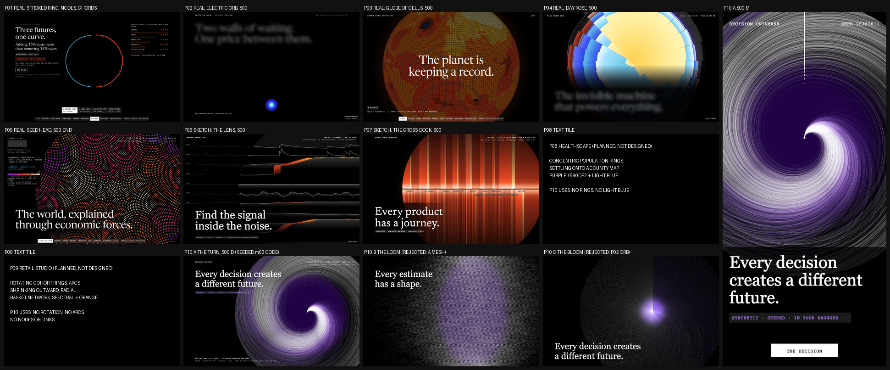

# Visual design: Decision Universe ("Every Decision Creates a Different Future")

This document covers phases 14-16: reference research, three competing concepts with a scored
selection, and the experience blueprint. The motion bible (phase 17) is `MOTION_SYSTEM.md`.
Author: Creative Director (task P10-CD-001), 2026-10-11.

## Contents

0. [Binding inputs](#0-binding-inputs)
1. [Reference research (phase 14)](#1-reference-research-phase-14)
2. [Three concepts and the selection (phase 15)](#2-three-concepts-and-the-selection-phase-15)
3. [Experience blueprint (phase 16)](#3-experience-blueprint-phase-16)
4. [Signature interactions](#4-signature-interactions)
5. [Copy deck](#5-copy-deck)
6. [Placeholder bindings and data requests](#6-placeholder-bindings-and-data-requests)
7. [Hard rejection criteria](#7-hard-rejection-criteria)

---

## 0. Binding inputs

These are inputs to the design. The design does not choose them.

- **Shared language.** `design/reference-analysis.md`, `design/interaction-inventory.md`, `shared/design-tokens/tokens.css` and `design/fonts/DECISION.md` (workspace root). Fonts: Newsreader (display) and JetBrains Mono (everything else). Ghost words are opacity 0.55 plus a 12px blur (ENGINEERING_DECISIONS #10).
- **What other projects own** (`docs/DESIGN_AUDIT.md`, ENGINEERING_DECISIONS #9-#42, MASTER_PLAN). Evidence opened for this task, all placed on the distinctness sheet (section 2):
  - P01 `artifacts/evidence/stage-b3/1440x900/06-futures-a-busier.png` (real frame)
  - P02 `artifacts/evidence/stage-a/1440x900/00-s00-t1250.png` (real frame)
  - P03 `artifacts/evidence/stage-a/1440x900/01-s00-t4600-end.png` (real frame)
  - P04 `artifacts/evidence/stage-b/1440x900/fix1-s00-t3500.png` (real frame)
  - P05 `artifacts/evidence/stage-a/1440x900/01-s00-t4600-end.png` (real frame)
  - P06 `design/sketches/lens-s00-d.png` and P07 `design/sketches/dock-s00-d.png` (sketches: no evidence frames yet)
  - P08 and P09: nothing designed; text tiles naming their planned forms.

  What each project owns:
  - **P01** a 164vw *stroked* ring with nodes on its circumference, chords, a stepping horizon dial, a two-colour left/right split (its real frame labels the left half OBSERVED), light-blue structure with travelling orange pulses.
  - **P02** rectilinear depth walls and a smooth Electric glow orb that contracts to a marker.
  - **P03** a Solar orb resolving into a sphere of square cells with a limb, an unwrap and a vertical core of strata.
  - **P04** a filled area-true 24-petal rose: wedges, spokes, time as angle with noon at the top.
  - **P05** a disc of countable grains on a golden-angle lattice (its real frame shows swirling parastichies).
  - **P06** a giant unstroked circle (the Lens) over horizontal telemetry traces; the only trace-based site.
  - **P07** an area-true disc of vertical bars cut by a horizontal dock seam.
  - **Planned:** P08 concentric population rings settling onto a county map (purple with light blue); P09 rotating cohort rings, shrinking arcs and a radial basket network (Spectral with orange-red).
- **Cross-project review note (2026-10-11).** Every site from P04 on sets its own accent pair, and the "frame-filling radial disc with a lower-left headline" composition (P04 and P05 both use it) is not to be repeated. P10's S00 headline sits **top-left**, never lower-left, and the giant form is offset right (section 3.3).
- **The plan's identity collides.** "A central decision orb branching into a radial probability field" is P02's orb at the centre and a P04/P05-style radial field around it. Rendered from real seeded futures (`bloom-s00-d.png`), it reads at contact scale as a glowing blue-violet orb in a dim disc with a lower-left headline: rejected (section 2).
- **Data contracts read on 2026-10-11** (commit `2b9b117`): `docs/DATA_CONTRACTS.md`, `docs/PROBLEM.md` and 13 schemas in `data/contracts/`, which fix top-level keys only. The **published artifacts** (`site/public/data/*.json`, commit `b50e0fc`, "Build status: data passed") were then read field by field; section 6 binds to their real inner keys and asks only for what is missing (DR-1 to DR-7).
- **What the reference code says** (untracked `analytics/` work in progress, read only, never edited):
  - PRNG: xoshiro128** seeded by splitmix32 x4; `uniform()` 53 bits from two u32; `normal()` Box-Muller with a one-value cache (`analytics/rng.py`). Master seed 20261011 (`pipelines/common.py`).
  - The hero environment is m03's **project NPV** (`analytics/mc.py`), SYNTHETIC, USD millions, 8 years, cash at year end: investment I lognormal(ln 100, 0.15); first-year revenue N(48, 8); growth triangular(-0.02, 0.06, 0.15); margin N(0.35, 0.05); discount rate U(0.07, 0.12). NPV = -I + sum of discounted cash.
  - **My computation, not a binding** (seed 20261011, n 20,000, the reference `run`): mean NPV 11.09 M, SD 32.39, SE 0.229, 95% CI of the mean 10.64 to 11.54, P(loss) 0.3798, p05 -38.87, p50 9.34, p95 67.17. In the 2,500-future sketch, 61.6% complete the turn (pay back) within 8 years.
  - **My computation, not a binding** (NSW Dehejia-Wahba, read from `data/raw` into memory only): experimental difference in mean 1978 earnings, treated minus control, 1,794.34 USD (185 vs 260); the naive comparison with 2,490 PSID controls is -15,204.78 USD. The page binds `m10.nsw.benchmark.estimate` (1,794.34, it agrees) and `m10.nsw.observational_estimators`, never these.
  - German Credit: cost matrix 5 (bad approved) : 1 (good rejected), theoretical calibrated threshold 1/6 (`analytics/credit.py` docstring); test set 250 (DATA_CONTRACTS).
- **Honesty rules from the brief and PROBLEM.md** (binding on every view):
  1. Seeded environments are SYNTHETIC, labelled from the first S00 frame. The only OBSERVED data are NSW/PSID earnings (module 10) and German Credit (modules 6 and 9).
  2. Live recompute is labelled `RUNNING IN YOUR BROWSER` (with the seed). The words "AI", "smart" and "intelligent" never appear.
  3. Precomputed outputs say `PRECOMPUTED · PYTHON REFERENCE`. Browser results show their parity status against the published vectors.
  4. Credible intervals and confidence intervals use **different mark types** and different words, never one for the other (section "Interval grammar").
  5. Model counterfactuals (module 9) carry `MODEL COUNTERFACTUAL · NOT A CAUSAL CLAIM` wherever shown.
  6. Every observational causal estimate is shown **beside the NSW experimental benchmark**, with its gap and the DAG assumptions it relies on.
  7. Seeds are on screen wherever random numbers are used.
  8. Attributions on screen: NBER Dehejia data page link plus the three papers (required by its terms), UCI German Credit citation (CC BY 4.0), Ishigami/Saltelli citations, HiGHS.
- **Sketches** (original, rendered by `design/sketches/render_sketches.py` from the project's own seeded reference code; rasterized by `render_sheet.mjs`; composed by `compose_sheet.py`):
  - `turn-s00-d.png`, `turn-s00-m.png`: concept A at S00, D and M
  - `loom-s00-d.png`: concept B (rejected)
  - `bloom-s00-d.png`: concept C, the plan's form (rejected)
  - `distinctness-sheet.png`: the contact-scale comparison against P01-P09
  - `p04-p05-p10-grey.png`: the greyscale watch-item check against the two other frame-filling circular textures
- **What we take from the reference** (principles only): black stages lit by one luminous form, oversized serif statements revealed word by word through blur, uppercase mono UI, 100dvh sticky stages in long tracks, threshold-stepped 1.2s settles, 4-segment story cards, an argument card stack, a square blur bottom nav with a mobile current-section pill, a closing that echoes the opening. We do **not** take its ring dial: our circle has no outline, nothing on its circumference, and never rotates.

### The Turn: encoding (binding)

The giant circular element is **the Turn**: every seeded future of one investment decision drawn as a white thread that leaves the decision point and winds clockwise as cash comes back. **One full turn is the money back.**

| Aspect | Rule |
|---|---|
| **Thread** | One per seeded future of the m03 environment, keyed by its draw index (the same index is the same simulated world under every decision: common random numbers, DR-2) |
| **Radius** | Years since the decision, linear: centre = the decision (year 0), rim = year 8. `r = R × t / 8` |
| **Angle** | Cash recovered so far as a share of **that future's own investment**, clockwise from 12 o'clock: `θ = 360° × PVcash(t) / I`. A thread that reaches 12 o'clock again has paid back; past 12 o'clock is positive NPV. Every thread starts pointing straight up, because at year 0 nothing is recovered |
| **Between year ends** | Cash arrives at year end in the model; threads interpolate `PVcash/I` linearly within each year (12 samples per year) so a thread is a curve, not a staircase of arcs. The caption says so: `DRAWN AS IF CASH ARRIVED EVENLY · THE MODEL PAYS AT YEAR END` |
| **Colour** | Final NPV ≥ 0: white `#FFFFFF`. NPV < 0: violet `#B48CFF`. Additive (screen) blending at 16% per thread, so density is brightness. No other hue on a thread |
| **Glow** | One static glow pass: the threads themselves rendered at 1/4 resolution, blurred 24px, tinted `#690DE2`, screen-blended at 40%. It follows the threads. **Never a smooth disc and never a glow centred on the decision point** |
| **Decision point** | A 4px white square at the centre. It never glows, never grows, never shrinks, and never moves relative to the threads |
| **Payback ladder** | Where a thread first completes its turn, a 2px white square on the 12 o'clock ray at that radius (year), 40% opacity. Their density along the ray is the payback-year distribution. The ray itself is never drawn |
| **Rim** | No stroke. The circle exists because every thread ends at year 8, the shared horizon |
| **Unit line** | Every Turn view prints `OUTWARD = YEARS · ONE FULL TURN = MONEY BACK · {{n_drawn}} OF {{n}} FUTURES DRAWN · SEED {{seed}}` |
| **Never** | A stroked circle, guide rings or year rings; ticks, nodes or labels on the circumference; spokes, wedges, petals or straight radial rays; dots tiling the disc; a central orb or any glow brighter at the centre than the threads around it; rotation of the whole form (threads grow and re-wind; the form never spins); time running left to right; a second hue on threads; a pie-like sector fill |

**Why a circle, and why a turn.** "Getting your money back" is a full turn: what goes out comes back round. A future that pays back completes the circle; one that loses never closes it. Because every future in the environment shares the same eight-year horizon, the threads all end on the same rim, so the circle is not drawn, it is where time runs out. And because the threads share a seed per index, changing the decision re-winds **the same worlds**: every decision creates a different future, visibly, thread by thread.

**The second view: the Unroll.** From S04 on, the Turn unrolls into a vertical **waterfall** of the same threads: angle becomes x (share recovered, 0% at the left, 100% marked by the payback line), radius becomes y (years, **downward**). Time never runs left to right anywhere on the site (P06 owns horizontal traces).

### Colour semantics (project 10 accent pair: violet and white)

| Role | Value | Contrast on `#000` | Rule |
|---|---|---|---|
| Futures that pay back; the decision point; OBSERVED marks | `#FFFFFF` | 21 | Threads, the decision square, real-data marks |
| Futures that lose; SYNTHETIC structure lines; credible-interval edges | `#B48CFF` (`--tag-synthetic`) | 8.1 | Lines and 11px+ text |
| The glow, credible-interval fills, active control blocks, the violet story card | `#690DE2` fill only | 2.8 | White text on it (7.6:1). **Never** a line, text or data mark |
| DERIVED readouts | `#58B8E1` (`--tag-derived`) | 9.4 | Chip text and readouts only. **Never a line, thread or structure** (P08 owns light-blue structure) |
| PREDICTED (forecast, credit probabilities) | `#8FA2FF` (`--tag-predicted`) | 8.8 | Chip text, prediction-interval label |
| Status | `--state-success`, `--state-warning`, `--state-error` | ≥ 7 | Parity `MATCH` / `MISMATCH`, solver status words |

- **Accent decision.** The plan said "Electric violet-to-blue with luminous white trajectories". **Kept as violet plus white; the blue is dropped.** P02 owns the Electric blue orb, and P08 owns purple with light-blue structure, so P10 never uses light blue on a mark and never puts blue in the glow. Violet as the luminous mass was reserved for P10 by P07, which rejected its own all-violet colourway for that reason (P07 VISUAL_DESIGN, section "Colour semantics"). P10's pair is therefore violet `#690DE2`/`#B48CFF` with white, and it reads on the sheet as a white-and-violet vortex next to P08's planned purple rings.
- White vs violet differ in luminance (21 vs 8.1), so gain and loss survive greyscale (`p04-p05-p10-grey.png`).

### Interval grammar (credible, confidence, prediction)

| Kind | Mark | Words (always spelled out) | Where |
|---|---|---|---|
| **Credible interval** (Bayesian, equal-tailed) | A **filled** luminous band: `#690DE2` fill at 70% with 1px `#B48CFF` edges and a 6px inner glow. "Where the belief is" | `95% CREDIBLE INTERVAL · PROBABILITY THE RATE IS INSIDE, GIVEN THE PRIOR AND THE DATA` | S03b, LAB |
| **Confidence interval** (frequentist: Wilson, z, bootstrap) | **Hollow brackets**: 1px white horizontal line with 8px vertical end ticks, no fill. "A net cast by a procedure" | `95% CONFIDENCE INTERVAL · THE PROCEDURE COVERS THE TRUE VALUE IN 95% OF REPEATED SAMPLES` | S03a (CI of the mean), S03b, S06b, S07 |
| **Prediction interval** (forecast) | **Two dashed hairlines** (4px on, 4px off) bounding the waterfall at each horizon, no fill | `80% / 95% PREDICTION INTERVAL · WHERE THE NEXT VALUES SHOULD LAND · COVERED {{k}} OF {{n}}` | S04 |

Side by side in S03b, a credible interval and a confidence interval on the same data are always drawn **one above the other**, each with its own words, and never in the same colour or mark. A test asserts that no element carrying `data-interval="credible"` has a sibling label containing "confidence", and vice versa.

### Tags and the chip

Every visual carries one chip (13px mono, 8px padding, `#ffffff1a` background, text in the tag colour); the chip text comes from the artifact's `tags` map, never from this document. The footer on every scene from S01 on (12px mono, 50% white): `meta.licence_note`, `SEED {{meta.seed}}`, the citation line for the scene's dataset (NBER link plus three papers for S07; UCI for S05) and `meta.limitations[0]` verbatim.

---

## 1. Reference research (phase 14)

Each reference was verified on 2026-10-11 from this machine:

- **C:** `curl -L` with a desktop user agent returned HTTP 200, and the page title was read (quoted).
- **R:** the orchestrator's captured reference walk (`design/reference/`).
- **F:** a fact read from a file in this repository.

**The Motion column describes, it does not observe.** Unless a row is marked R, I did not watch its motion for this task, and nothing here claims an observed interaction.

Excluded after checking (not cited): `en.wikipedia.org/wiki/Ishigami_function` (404), `en.wikipedia.org/wiki/Common_random_numbers` (404), `en.wikipedia.org/wiki/Hurricane_forecast_cone` (404).

| # | Reference (URL) | Verified | Technique | Motion (described, not observed, unless R) | Strength for us | Implementation direction | Originality strategy |
|---|---|---|---|---|---|---|---|
| 1 | Blink Capital, https://blink.capital/ | R | 100dvh sticky stages, story cards, chat stack, blur bottom nav, one luminous form | Observed: 1.2s `cubic-bezier(.33,1,.68,1)` stepped settles, word blur reveal, instant nav jumps | The mandatory grammar | Principles only, through the shared shell and tokens | Our luminous form is a vortex of seeded futures; no ring, no dial, no rotation, no outline |
| 2 | Wikipedia, "Monte Carlo method", https://en.wikipedia.org/wiki/Monte_Carlo_method | C ("Monte Carlo method - Wikipedia") | Repeated random sampling | n/a | The engine of the hero | S03a convergence: SE shrinks as 1/√n | Every draw is a visible thread, not a histogram bar |
| 3 | Wikipedia, "Net present value", https://en.wikipedia.org/wiki/Net_present_value | C ("Net present value - Wikipedia") | Discounted cash | n/a | The hero's outcome | The angle is discounted cash over investment | NPV read as "how far past the top the thread ends" |
| 4 | Wikipedia, "Payback period", https://en.wikipedia.org/wiki/Payback_period | C ("Payback period - Wikipedia") | Time to recover the investment | n/a | Makes the turn meaningful | The payback ladder on the 12 o'clock ray (discounted payback) | Payback is a geometric event: the thread closes its circle |
| 5 | Wikipedia, "Fan chart (time series)", https://en.wikipedia.org/wiki/Fan_chart_(time_series) | C ("Fan chart (time series) - Wikipedia") | Shaded quantile bands widening in time | n/a | **Anti-reference**: the default picture of uncertain futures | Rejection criterion 2: no shaded quantile fan anywhere | Every future is a thread; bands appear only as interval marks with words |
| 6 | Wikipedia, "Spaghetti plot", https://en.wikipedia.org/wiki/Spaghetti_plot | C ("Spaghetti plot - Wikipedia") | Many trajectories on time vs value axes | n/a | **Anti-reference**: threads on a horizontal time axis | Time is radius (the Turn) or downward (the Unroll), never left to right; no axes box | The same threads, wound into a turn whose geometry carries payback |
| 7 | Wikipedia, "Galton board" (requested as Bean machine), https://en.wikipedia.org/wiki/Bean_machine | C ("Galton board - Wikipedia") | Balls falling through pegs into a binomial pile | n/a | **Anti-reference**: the textbook image of chance | No pegs, no pile, no falling balls | n/a |
| 8 | Wikipedia, "Pie chart", https://en.wikipedia.org/wiki/Pie_chart | C ("Pie chart - Wikipedia") | Probability as angular sector | n/a | **Anti-reference** | Rejection criterion 2: no filled sectors; violet threads are not a wedge | Angle is money recovered, carried by each thread |
| 9 | Wikipedia, "Polar coordinate system", https://en.wikipedia.org/wiki/Polar_coordinate_system | C ("Polar coordinate system - Wikipedia") | (r, θ) | n/a | The Turn's coordinates | Vertex shader polar mapping, Vitest parity on 16 published threads (DR-1) | Polar with a stated meaning for both coordinates, and no polar grid |
| 10 | Wikipedia, "Archimedean spiral", https://en.wikipedia.org/wiki/Archimedean_spiral | C ("Archimedean spiral - Wikipedia") | r proportional to θ | n/a | A constant-cash future is an Archimedean spiral; real ones bend away from it | The S00 caption explains why some threads curl tighter (faster recovery) | Each thread's departure from the spiral is its growth and discounting |
| 11 | Wikipedia, "Vortex", https://en.wikipedia.org/wiki/Vortex | C ("Vortex - Wikipedia") | Flow around a centre | n/a | The gestalt: a single swirl of light | One luminous form, white and violet | Every streamline is a seeded future; nothing flows for decoration |
| 12 | Wikipedia, "Star trail", https://en.wikipedia.org/wiki/Star_trail | C ("Star trail - Wikipedia") | Long-exposure arcs | n/a | **Anti-reference**: concentric arcs around a pole (P08/P09 territory) | No concentric arcs; threads spiral outward | n/a |
| 13 | Wikipedia, "The Garden of Forking Paths", https://en.wikipedia.org/wiki/Garden_of_Forking_Paths | C ("The Garden of Forking Paths - Wikipedia") | Branching futures as literature | n/a | The tagline's idea | S01 statement and S08 echo | We show futures as threads from one point, not a branching tree |
| 14 | Wikipedia, "Many-worlds interpretation", https://en.wikipedia.org/wiki/Many-worlds_interpretation | C ("Many-worlds interpretation - Wikipedia") | Worlds splitting | n/a | Vocabulary only ("worlds") | Copy uses "simulated world", never physics claims | n/a |
| 15 | Wikipedia, "Xorshift", https://en.wikipedia.org/wiki/Xorshift | C ("Xorshift - Wikipedia") | The xoshiro family | n/a | S02 card 1 | The generator named on screen with its seed | Its first outputs printed and checked live |
| 16 | Vigna, "A PRNG shootout", https://prng.di.unimi.it/ | C ("A PRNG shootout") | xoshiro128** reference | n/a | The generator's primary source | Cited on S02 card 1 and in S07 | n/a |
| 17 | Wikipedia, "Box-Muller transform", https://en.wikipedia.org/wiki/Box%E2%80%93Muller_transform | C ("Box–Muller transform - Wikipedia") | Two uniforms to two normals | n/a | `normal()` in `analytics/rng.py` | S02 card 2 copy; parity of `normal_first` | n/a |
| 18 | Wikipedia, "Credible interval", https://en.wikipedia.org/wiki/Credible_interval | C ("Credible interval - Wikipedia") | Bayesian interval | n/a | The filled-band mark and its words | Interval grammar | Two intervals drawn as two different objects |
| 19 | Wikipedia, "Confidence interval", https://en.wikipedia.org/wiki/Confidence_interval | C ("Confidence interval - Wikipedia") | Frequentist coverage | n/a | The bracket mark and its words | Interval grammar; S03b exact coverage | n/a |
| 20 | Wikipedia, "Prediction interval", https://en.wikipedia.org/wiki/Prediction_interval | C ("Prediction interval - Wikipedia") | Interval for a new observation | n/a | The dashed-hairline mark | S04 with its covered count | Coverage counted live, interval by interval |
| 21 | UCI, "Statlog (German Credit Data)", https://archive.ics.uci.edu/dataset/144/statlog+german+credit+data | C ("UCI Machine Learning Repository") | Real applicants and a published 5:1 cost matrix | n/a | The only real classification data | S05 and its citation (CC BY 4.0) | The cost matrix is an editable input whose default is the published one |
| 22 | Dehejia, NSW data page, https://users.nber.org/~rdehejia/nswdata2.html | C ("Data") | NSW experiment and PSID controls | n/a | The experimental benchmark | S07, the link required by its terms, three papers cited | The benchmark stands beside every observational estimate |
| 23 | Wikipedia, "Rubin causal model", https://en.wikipedia.org/wiki/Rubin_causal_model | C ("Rubin causal model - Wikipedia") | Potential outcomes | n/a | "The future you didn't choose" | S07 framing | The unchosen future drawn as a ghost thread, never as data |
| 24 | Wikipedia, "Directed acyclic graph", https://en.wikipedia.org/wiki/Directed_acyclic_graph | C ("Directed acyclic graph - Wikipedia") | The causal DAG | n/a | Assumptions made visible | S07 DAG from `m10.dag` | Edges drawn as straight hairlines, nodes as mono words; no physics layout |
| 25 | Wikipedia, "Counterfactual thinking", https://en.wikipedia.org/wiki/Counterfactual_thinking | C ("Counterfactual thinking - Wikipedia") | "What if" | n/a | The everyday sense the site must separate from causal claims | S05b label: MODEL COUNTERFACTUAL · NOT A CAUSAL CLAIM | n/a |
| 26 | Wikipedia, "Pareto front", https://en.wikipedia.org/wiki/Pareto_front | C ("Pareto frontier - Wikipedia") | Efficient trade-offs | n/a | S06a vocabulary | Epsilon-constraint front from `m07.front` | Points are solves; the curve between them is never interpolated |
| 27 | HiGHS documentation, https://ergo-code.github.io/HiGHS/dev/ | C ("About · HiGHS Documentation") | The LP solver | n/a | Reference and browser solver | Status words shown verbatim | n/a |
| 28 | lovasoa, highs-js, https://github.com/lovasoa/highs-js | C ("GitHub - lovasoa/highs-js: Javascript linear programming library · GitHub") | HiGHS in WebAssembly | n/a | Live S06a solves | Module worker, highs@1.15.3 (ED #21), lazy at S06a | n/a |
| 29 | Wikipedia, "Variance-based sensitivity analysis", https://en.wikipedia.org/wiki/Variance-based_sensitivity_analysis | C ("Variance-based sensitivity analysis - Wikipedia") | Sobol indices | n/a | S06b | Analytic vs Saltelli estimates by N | n/a |
| 30 | Surjanovic and Bingham, "Ishigami Function", https://www.sfu.ca/~ssurjano/ishigami.html | C ("Ishigami Function") | The test function, a = 7, b = 0.1 | n/a | S06b's honest benchmark | Constants printed on screen | Inputs on [-π, π] shown as what they are: angles |
| 31 | MDN, `drawArraysInstanced()`, https://developer.mozilla.org/en-US/docs/Web/API/WebGL2RenderingContext/drawArraysInstanced | C ("WebGL2RenderingContext: drawArraysInstanced() method - Web APIs \| MDN") | One draw call for N threads | n/a | GPU instancing | MOTION_SYSTEM 9.1 | n/a |
| 32 | MDN, "Using Web Workers", https://developer.mozilla.org/en-US/docs/Web/API/Web_Workers_API/Using_web_workers | C ("Using Web Workers - Web APIs \| MDN") | Off-main-thread compute | n/a | The ten modules run in a worker | Transferable `Float32Array`s | n/a |
| 33 | MDN, OffscreenCanvas, https://developer.mozilla.org/en-US/docs/Web/API/OffscreenCanvas | C ("OffscreenCanvas - Web APIs \| MDN") | Rendering off the main thread | n/a | Considered, not used | Main-thread WebGL2 (one context, simpler resize and a11y); revisit only if long tasks appear | n/a |
| 34 | MDN, `navigator.hardwareConcurrency`, https://developer.mozilla.org/en-US/docs/Web/API/Navigator/hardwareConcurrency | C ("Navigator: hardwareConcurrency property - Web APIs \| MDN") | Device hint | n/a | Initial tier guess | Tier starts from it, then frame timing decides | n/a |
| 35 | Lenis, https://lenis.darkroom.engineering/ | C ("Lenis – Smooth Scroll") | Normalized smooth scroll | Inertial scroll | The shared shell's progress loop | n/a | n/a |
| 36 | Brown University, "Seeing Theory", https://seeing-theory.brown.edu/ | C ("Seeing Theory") | Interactive probability lessons | Described | **Anti-reference** for tone: the textbook-lesson look (axes, coins, dice, chapter UI) | Rejection criterion 3 | One luminous form, editorial statements, no lesson chrome |
| 37 | The Pudding, "Human Terrain", https://pudding.cool/2018/10/city_3d/ | C ("Human Terrain") | Data made physical | Scroll camera (described) | Matter as data | Threads as a physical swirl | No 3D terrain |
| 38 | Igloo Inc (Awwwards SOTD), https://www.awwwards.com/sites/igloo-inc | C ("Igloo Inc - Awwwards SOTD") | Cinematic intro handing off to scroll | Described | Intro pacing | 4.8s skippable First Turn | A decision growing its futures, not a camera flight |
| 39 | Active Theory V6 (Awwwards SOTD), https://www.awwwards.com/sites/active-theory-v6 | C ("Active Theory V6 - Awwwards SOTD") | One dominant form across a site | Described | The Turn carries S00-S08 | n/a | Data-bound threads, raw WebGL2 |
| 40 | `analytics/rng.py`, `analytics/mc.py`, `analytics/credit.py` | F | Generator, environment, cost matrix | n/a | The sketch's numbers | Sketch only; the page binds artifacts | n/a |

---

## 2. Three concepts and the selection (phase 15)

All three use the shared family (black stages, Newsreader statements, mono UI, sticky stages, story cards, the argument stack, the bottom blur nav, a closing echo). What differs is the metaphor, the giant circle, the scene composition and the closing. Each was **rendered from the project's own seeded reference code** before scoring.

Tests applied to every candidate (from the brief and the review): time may not run left to right (P06) or be angle around a centre (P04, P01); no stroked circle and no circle split into halves (P01); no bundle converging on two poles (P03's meridians); every position bound to a field or stated maths; no textbook figure (fan chart, Galton board, spaghetti plot, pie, sunburst, Venn, polar line); not the "frame-filling radial disc with a lower-left headline".

### Concept A: "The Turn"

- **Philosophy.** A decision sends money out; the future decides how it comes back. Draw every simulated future as a thread that winds clockwise as cash returns: one full turn is the money back. Change the decision and the same worlds re-wind.
- **Signature geometry.** The Turn (section 0), and its unrolled form, the waterfall (S04).
- **Accent.** White futures that pay, violet futures that lose, a violet glow from the threads.
- **Layout.** Asymmetric: statement top-left, the Turn offset right and cropped (D), the Turn above the statement (M).
- **3D/2D.** Raw WebGL2, one instanced draw of line segments, every animation a uniform (MOTION_SYSTEM 9). Canvas2D LOW tier.
- **Hero.** One white square: `INVEST 100 M USD?`. Eight beats, one per year: the threads leave it together, wind, separate; some close the turn, some never do.
- **Nav labels.** FUTURES · ANOTHER DECISION · WHAT IS REAL · ENOUGH · LEARNING · UNROLL · THE LINE · TRADE-OFFS · UNCHOSEN · THE LAB
- **Motion character.** Threads grow outward (time), re-wind in angle (decisions), unroll (S04). Nothing rotates as a body, nothing pulses, nothing travels along a thread.

### Concept B: "The Loom"

- **Philosophy.** Every estimate has a shape: the sampling error of an empirical distribution is a Brownian bridge, pinned at 0% and 100%, widest at 50%, and its 95% envelope is an exact circle once the axes are scaled. Thousands of seeded samples weave the circle.
- **Rendered** (`loom-s00-d.png`, 1,200 seeded 250-draw samples, the German test-set size): the threads are step functions, so at contact scale they read as a **diagonal mesh**, a fabric texture with no circle; with smoothing they would read as meridians between two poles (P03). The message ("estimates are uncertain") is also off the tagline: it is about samples, not decisions.
- **Kept:** the bridge survives as one S02 card visual (sampling), where it is the right idea.

### Concept C: "The Bloom" (the plan's form)

- **Philosophy.** A central decision orb branching into a radial probability field: rays outward in time, each future at an angle given by its current rank.
- **Rendered** (`bloom-s00-d.png`, 1,500 futures): a glowing orb at the centre (P02), a dim radial disc (P04/P05 family), the rank seam at 12 o'clock as a hard vertical line, and the headline in the lower left: exactly the composition the review rules out. Angle = rank is honest but shows no spread at all (ranks are always uniform), so the picture hides the uncertainty it is meant to show.

### Scores (1 = poor, 5 = excellent)

| Criterion | A The Turn | B The Loom | C The Bloom |
|---|---|---|---|
| Fidelity to the reference language (one luminous form, statements, cards, stack, stepped settles, closing echo) | 5 | 3 | 4 |
| Analytical clarity (spread, P(loss), payback, decision effect, convergence all legible) | 4 | 2 | 2 |
| **Distinct from P01-P09**, on the sheet with real frames | 5 | 3 | 1 |
| **Never reads as a stats-textbook figure or chart library** | 4 | 2 | 3 |
| Accent distinct (P02 blue orb, P08 purple + light blue) | 5 | 4 | 2 |
| Feasibility on static Pages (Lighthouse 90+, 60fps D / 30fps M) | 4 | 5 | 4 |
| Data honesty (every coordinate stated, seeds, tags) | 5 | 5 | 3 |
| Mobile quality | 4 | 3 | 3 |
| Memorability | 5 | 2 | 3 |
| **Total (of 45)** | **41** | **29** | **25** |

**Why A gets 5 for distinctness** (checked at 240px tiles, ED #17):

1. **Not P01.** P01 is a thin stroked ring of uniform width split left/right in two colours, with nodes and chords. The Turn has no stroke and no hollow ring; it is a dense swirl whose width grows from a hook at the centre to the full disc, with no nodes and no split.
2. **Not P02.** P02 is a small smooth blue glow. The Turn's centre is a 4px square inside a dark violet eye; the brightness lives in the arms.
3. **Not P03.** No sphere, no cells, no limb, no grid in two directions.
4. **Not P04.** P04 is filled wedges in hard-edged bands from the centre. The Turn has no wedge, no spoke, no straight edge; every mark is a curve.
5. **Not P05.** P05 is dots on a lattice whose parastichies swirl faintly. The greyscale pair (`p04-p05-p10-grey.png`) shows the difference without hue: P05 is a uniform dotted texture filling the frame; the Turn is one coherent vortex of continuous lines with a black eye and black corners.
6. **Not P06/P07.** No horizontal traces, no aperture; no bars, no dock.
7. **Not the planned P08/P09.** No concentric rings, no rotation, no arcs standing alone, no nodes or links.

**Why 4, not 5, for "never a textbook figure".** A polar line chart is a real chart type (reference 9). The fence is section 7: no polar grid, no angle labels, no ring ticks, no axes; the unit line in words; every thread a seeded future.

**Why 4 for feasibility.** 12,000 additive threads x 96 segments at DPR 1.5 is about 70M fragment writes per frame on D (MOTION_SYSTEM 9.2). It fits a 2020-class integrated GPU at 60fps only because the form is static between transitions (redrawn on change, not every frame). The LOW tier is a real fallback, not a promise.

**Watch items.** (a) The payback ladder at contact scale reads as a thin vertical line above the centre; the build must keep it as 2px squares at 40% with gaps visible at 1440, never a continuous stroke (rejection criterion 2). (b) P09's future cohort rings must stay clear of a swirl; recorded for P09's Creative Director.

### Selection: A, "The Turn", with two grafts

- **From B:** the bridge is the right picture for sampling error, so it is the S02 card 1 visual (the seed card): 64 seeded samples of the m02 stream as bridges, with `widest at 50%` in words.
- **From C:** "the future you didn't choose" keeps the plan's branching idea as a **ghost thread**: in S01 and S07 the unchosen decision's version of a world is drawn at 25% beside the chosen one, keyed by draw index.

**Departures from MASTER_PLAN.**
- "A central decision orb branching into a radial probability field" becomes the Turn: the decision is a 4px square (never an orb), and futures wind outward with a stated meaning for both coordinates.
- "Electric violet-to-blue" becomes violet and white; blue is dropped (P02, P08).
- "Trajectories reorganize into the decision landscape" is kept as the S04 Unroll and the S01 re-wind; the landscape is the waterfall of the same threads.
- "Live recompute in a worker" is kept; GPU-instanced trajectories are raw WebGL2, not three.js (precedents #19, #24).

---

## 3. Experience blueprint (phase 16)

### 3.1 Chapter-to-scene map

| Scene | Directive chapter | Nav label | Track | Module(s) | Kind |
|---|---|---|---|---|---|
| S00 Opening | The First Turn | (none, overlay) | 0 (fixed overlay, 4.8s or less) | m03 | Timed intro, skippable |
| S01 Big Idea | Same worlds, another decision | ANOTHER DECISION | 250vh | m03 | Scrubbed statement, then a stepped decision re-wind |
| S02 Origin of the Data | What is real, what is invented | WHAT IS REAL | 300vh | m02, m01, German Credit, NSW | Story-card deck |
| S03a Mechanism I | How many futures are enough | ENOUGH | 250vh | m03 | 5 stepped n values |
| S03b Mechanism II | Learning narrows a belief | LEARNING | 300vh | m04 | Sequential update, then credible vs confidence |
| S04 Transformation | The turn unrolls | UNROLL | 300vh | m03, m05 | Unroll, then forecast intervals with coverage |
| S05 Experiment | Draw the line | THE LINE | 300vh | m06, m09 | Threshold and cost ratio; model counterfactuals |
| S06 Consequences | What you trade, what matters | TRADE-OFFS | 300vh | m07, m08 | Pareto with live HiGHS; Sobol by N |
| S07 Evidence | The future you didn't choose | UNCHOSEN | 300vh | m10, validation | Benchmark vs estimators, DAG, then the argument stack |
| THE LAB | Ten instruments | THE LAB | 100dvh minimum, **not pinned** | all ten | Free exploration and in-browser parity |
| S08 Conclusion | Every decision, again | (none; THE LAB stays active) | 200vh | m03 | The Turn on the visitor's decision and seed |

The FUTURES nav item targets S00's end state (top of page). Total about 2,550vh. If the QA recording shows fatigue, cut S06 to 250vh first, then S03b.

### 3.2 Global layout constants

- **Viewports:** D = 1440x900, T = 768x1024, M = 390x844.
- **Grid:** D 12 columns, 96px margins, text column x 96-620. T 8 columns, 48px margins. M 4 columns, 16px margins.
- **Nav:** bottom bar 12px from the bottom on D; a 160x32 MENU pill on T/M showing the current section; SKIP INTRO / REPLAY bottom right.
- **Safe zone:** nothing interactive within 64px of the bottom on D, 72px on T/M.
- **One WebGL2 canvas** (fixed, viewport-sized, DPR capped per tier) draws the Turn, the waterfall and the S07 ghost threads. **One Canvas2D overlay** draws marks that are not threads (interval marks, the payback ladder, the credit column, the Pareto points, the DAG edges). All text and controls are DOM.
- **One module worker** (`compute.worker`) owns the PRNG and all ten modules; it is created after first paint. A second worker owns HiGHS-wasm, created at S06 entry or a LAB deep link.

### 3.3 Geometry states (exact)

`c` = Turn centre in CSS px; `R` = radius at year 8.

| State | D 1440x900 | T 768x1024 | M 390x844 | Notes |
|---|---|---|---|---|
| **G0 Giant** (S00, S01 start, S08 echo) | c (1010, 470), **R 590** (diameter 1.31 x frame height). Left arc visible x 420-560 at mid-height; top, right and bottom cropped | c (470, 700), R 620 (1.21 x). Headline band x 48-520, y 96-300 over a left-to-right top scrim (x 0-540); the top arc visible upper right (x 560-768, y 80-200) outside the scrim; left, right and bottom cropped | c (195, 300), R 460 (diameter 1.09 x frame height, 2.36 x frame width). Centre and the 12 o'clock ray in view; headline band y 560-740 under a scrim | **Statement never lower-left on D/T** (review note). The decision square and at least 0.8R of the 12 o'clock ray are visible on every viewport. M is under 1.2 x height by design: a larger R hides the centre behind the statement |
| G1 Aside (S01 compare, S02-S03b backdrop at 20%) | c (1120, 470), R 330 | c (384, 700), R 280 | c (195, 250), R 170 | |
| G2 Scene (S03a) | c (1000, 470), R 380 | c (384, 560), R 330 | c (195, 330), R 180 | |
| PAIR (S01 step 2) | A c (700, 470), B c (1120, 470), R 230 each | c (384, 380) and (384, 760), R 170 | c (195, 270) and (195, 560), R 125 | Same draw indices, keyed; a hovered index lights in both |
| FALL (S04 waterfall) | x 560-1360 (0%-180% recovered), y 120-800 (years 0-8, downward) | x 48-720, y 360-960 | x 16-374, y 300-760 | 100% recovered is a gap of no light 2px wide, never a drawn line |
| G5 Lab (THE LAB) | c (980, 470), R 360 | c (384, 520), R 300 | c (195, 280), R 170 | |

- **Interpolation.** Between states, `c` interpolates linearly and `R` in log space: camera moves only. They never animate data.
- **Sketches.** `turn-s00-d.png` (G0 D) and `turn-s00-m.png` (an earlier M at R 330; the build uses R 460).

### 3.4 Scenes

**Shared state UI** (every data-backed scene):
- **Initial:** the decision square and the unit line; headings sharp.
- **Loading:** `LOADING {{artifact}} · 42%`; the percentage is real (bytes / Content-Length), or absent.
- **Computing** (worker): `RUNNING IN YOUR BROWSER · SEED {{seed}} · {{elapsed}} MS`, real elapsed time, no percentage. The previous state stays at 60%.
- **Error:** `COULD NOT LOAD {{artifact}} (HTTP 404)` plus RETRY (re-runs the same fetch). Schema-guard failure: `{{artifact}} FAILED ITS CHECKS` with RETRY. Worker failure: `BROWSER COMPUTE UNAVAILABLE · SHOWING PRECOMPUTED · PYTHON REFERENCE`.
- **Parity:** after any live recompute that has a published vector, `MATCHES PYTHON REFERENCE ({{k}} OF {{k}} VECTORS)` in `--state-success`, or `MISMATCH` in `--state-error` with the first differing field.
- **Empty:** scene-specific copy, never a blank canvas.
- **Disabled:** `aria-disabled`, 50% white, a tooltip with the reason.
- **Reset:** scene-specific (below).
No spinners, no artificial delays.

#### S00 Opening: the First Turn (overlay, 4.8s or less)

- **Composition** (timeline in MOTION_SYSTEM 5.1): black; the mono wordmark top-left; the 4px decision square at G0 `c` with `INVEST 100 M USD?` beside it; eight beats (years 1-8): the threads extend outward one year per beat, together at first, separating as they wind; payback squares appear on the 12 o'clock ray as threads close; the glow fades in after beat 8; the headline sharpens; the nav enters.
- **Per viewport:** D headline 72px, 2 lines, x 96, y 110-260, over a top-left scrim (x 0-760, y 0-330, black 88% to 0). T 56px, 3 lines, x 48, y 96-300, full-width top scrim. M 40px, 3 lines, y 580-700, scrim band y 540-760.
- **Corner labels.** Top-left `DECISION UNIVERSE`. Top-right line 1 `INVEST {{investment_mean}} M USD · {{n}} FUTURES · SEED {{seed}}`; line 2 (50%) the unit line.
- **Chip under the headline:** `SYNTHETIC · SEEDED · RUNNING IN YOUR BROWSER` from the first frame.
- **Caption bottom-left (D) / under the chip (T/M):** `{{payback_share}}% PAY BACK IN 8 YEARS · {{loss_share}}% NEVER COMPLETE THE TURN`; second line `WHITE = POSITIVE NPV · VIOLET = LOSS · SQUARES ON THE TOP LINE = PAYBACK YEAR`.
- **LCP rule.** `h1[data-hero]` is in the DOM from first paint as ghost text; WebGL init waits for first paint; the threads are never on the LCP path.
- **Insight.** One decision, thousands of futures; about six in ten close the circle.
- **Interaction:** 1 (The First Turn).
- **Reduced motion:** the end state at once.

#### S01 Big Idea: same worlds, another decision (250vh)

- **Statement** (scrubbed word reveal, p 0-0.3): "Same chance. Another decision. Different futures."
- **Steps** (p 0.35, 0.55, 0.75): the Turn moves G0 → G1, then splits into PAIR: decision A (`m03` default) left, decision B right (DR-2 presets: `PHASED`, `DELAY ONE YEAR`); threads re-wind from A to B keyed by index (MOTION_SYSTEM 5.5). Ledger per decision: mean NPV with its 95% CI of the mean (brackets), P(loss), median payback year.
- **Hover/tap a thread:** the same world lights in both Turns; the other decision's version is a 25% ghost beside it ("the future you didn't choose").
- **Control:** DECISION radio (A / B / C) re-winds the right-hand Turn live. `COMMON RANDOM NUMBERS: SAME {{n}} WORLDS, SAME SEED` under the pair.
- **Tags:** SYNTHETIC. **Reset:** decision A.

#### S02 Origin of the Data: what is real, what is invented (300vh, 4 story cards)

Card row as the reference deck (4 progress segments). The Turn at G1, 20%.
1. **The seed** (violet card): `xoshiro128** · splitmix32 · SEED 20261011`; the first 8 u32 values from `m02.first_1000_u32`, recomputed live in the worker and ticked ✓ one by one; the bridge visual (graft from B): 64 seeded samples as bridges, `SAMPLING ERROR IS WIDEST AT 50%`. Tag SYNTHETIC.
2. **Shapes of chance:** the five `m01.cases` distributions as luminous filled density silhouettes (stacked vertically, no axes), each with `INTEGRATES TO {{1 ± err}}` from `m01.checks`. Tag DERIVED.
3. **Real applicants:** German Credit, 1,000 rows, the 5:1 cost matrix as a 2x2 of words, `UCI · CC BY 4.0 · HOFMANN (1994)`. Tag OBSERVED.
4. **Real earnings:** NSW 445 (185 treated, 260 control) and PSID 2,490; `NBER · ATTRIBUTABLE NON-COMMERCIAL USE` with the link and the three papers; `15 EXACT DUPLICATE ROWS ARE REAL AND KEPT`. Tag OBSERVED.
Footer line on this scene: `EVERYTHING ELSE ON THIS SITE IS SYNTHETIC AND SEEDED`.

#### S03a Mechanism I: how many futures are enough (250vh, 5 steps)

- The Turn at G2. Steps n = 100, 1,000, 10,000, 100,000 (`m03.convergence` prefixes; up to 20,000 recomputed live, 100,000 labelled PRECOMPUTED) and the 20,000 published run (section 6 adjustments). Drawn threads cap at the tier's count; the ledger says `{{n_drawn}} DRAWN · STATISTICS FROM ALL {{n}}`.
- Ledger (left column): mean, SE, the 95% CI of the mean as brackets on a horizontal NPV ruler (no axis box: three numbers under it), P(loss). `100 x THE FUTURES, 10 x NARROWER` when n goes 1,000 → 100,000 (bound to the table).
- **Insight:** the spread of futures does not shrink with more draws; only the uncertainty about the average does. Copy says exactly that.
- **Reset:** n 20,000.

#### S03b Mechanism II: learning narrows a belief (300vh)

- **Composition:** the **belief column**: time (observations) runs **downward**; at each update, the credible interval is a filled violet band, its confidence interval brackets 12px below it. The column narrows as evidence arrives (`m04.sequential`). The Turn at 20% behind.
- **Steps:** prior only → after 10 → after 50 → after the full sequence → the coverage study (`m04.coverage`: exact coverage of each interval at the chosen true rates, as two rows of words with the numbers).
- **Control (P):** SUCCESS / FAILURE buttons add an observation (conjugate update live), PRIOR selector (`m04.beta_binomial` cases).
- **Words:** the interval grammar's sentences under each mark. Tags SYNTHETIC.
- **Reset:** the published sequence.

#### S04 Transformation: the turn unrolls (300vh)

- p 0-0.4: the Turn unrolls into FALL (angle → x, radius → y downward), threads keyed; the 100% line appears as a 2px gap; payback squares become the points where threads cross it.
- p 0.45-1: the waterfall hands over to the forecast (`m05`): the seeded AR(1) series as one white thread falling to "now", then its forecast threads (seeded paths) below with **dashed prediction-interval hairlines** at 80% and 95%; the coverage counter fills: `95% INTERVAL COVERED {{k}} OF {{n}} ({{pct}}%)`, per horizon (`m05.coverage`).
- **Control (P):** LEVEL 80 / 95; METHOD SES / AR(1) (`m05.fits`).
- **Tags:** SYNTHETIC/PREDICTED.

#### S05 Experiment: draw the line (300vh)

- **Composition:** the **credit column**: the 250 test applicants (`m06.test`) as 1px horizontal hairlines, 160px long, stacked by predicted P(bad) top (0) to bottom (1), white if actually good, violet if actually bad. The threshold is a white 1px line with a 44px handle; applicants below it are rejected (their hairlines dim to 40%). Right of it, the expected-cost thread (`m06.curve`), vertical, the same y scale; the minimum lit.
- Ledger: `COST PER APPLICANT {{cost}} · APPROVED BAD {{fn}} · REJECTED GOOD {{fp}}`; three reference marks on the column: `OPTIMUM {{t_opt}}`, `0.5`, `1/6 (THEORY, IF CALIBRATED)`; `m06.repeated_splits` range as brackets around the optimum.
- **Controls (P):** threshold drag (0.01 step, keyboard arrows), COST OF APPROVING A BAD LOAN 1-10 (default 5, the published matrix).
- **S05b, model counterfactuals** (p 0.7-1): the 8 `m09.applicants` as cards; choose one: the minimal change (`m09.results`) shown as before → after values, immutables locked with `CANNOT CHANGE`, and the label `MODEL COUNTERFACTUAL · NOT A CAUSAL CLAIM · WHAT FLIPS THIS MODEL, NOT WHAT CHANGES A LIFE`.
- **Tags:** OBSERVED (applicants, labels) / PREDICTED (probabilities). UCI citation in the footer.

#### S06 Consequences: what you trade, what matters (300vh)

- **S06a Trade-offs** (p 0-0.5): the Pareto front (`m07.front`) as luminous white points in an unboxed plane (objective names in words at the two ends), the two anchors violet. **Control (P):** EPSILON slider → a live HiGHS solve in the worker; the new point lands with its status word and `SOLVED IN YOUR BROWSER · HiGHS`; parity against `m07.vectors`.
- **S06b What matters** (p 0.5-1): Ishigami (a = 7, b = 0.1): three inputs as three angles (their domain is [-π, π]); total variance as one filled violet column split into S1, S2, S3 and the interaction share; analytic values (`m08.analytic`) as white ticks, estimates by N (`m08.sobol`) as one 1px tick per seeded replicate (section 6). **Control (P):** N stepper re-runs Saltelli live in the worker (`RUNNING IN YOUR BROWSER · SEED`).
- **Tags:** SYNTHETIC/DERIVED.

#### S07 Evidence: the future you didn't choose (300vh)

- p 0-0.55 **The unchosen.** One white vertical line: `EXPERIMENTAL BENCHMARK (NSW, RANDOMISED) {{benchmark}} USD` with its CI brackets. Each observational estimator (`m10.nsw.observational_estimators`: naive, OLS, regression adjustment, IPW; names and assumptions by DR-7) as a short white hairline with bootstrap CI brackets, stacked downward, each printing `GAP {{gap}} USD`. The DAG (`m10.dag`) to the left in mono words and straight hairlines; `m10.assumptions` listed under it. **Control (P):** ESTIMATOR selector highlights one row and its assumptions; SAMPLE: NSW CONTROLS / PSID CONTROLS; a SYNTHETIC CONFOUNDED WORLD toggle (`m10.synthetic`) where the true effect is known.
- p 0.6-1 **Argument stack** (7 exchanges, objection then answer): "Is this just random?" (seeds, parity counts); "Credible or confidence?"; "Is the model's counterfactual a cause?"; "Does the observational estimate work?" (the gaps); "Are the numbers checked?" (`validation.checks` passed count, `failures_recorded` verbatim); "Is any of this real?" (OBSERVED vs SYNTHETIC); "Who made the data?" (citations).
- **Tags:** OBSERVED/DERIVED (NSW), SYNTHETIC (synthetic world).

#### THE LAB: ten instruments (normal flow, 100dvh minimum)

- Left rail (floating glass controls, never a solid panel): the Turn's decision levers (DR-2 parameters), SEED (a number field; changing it re-runs everything seeded), FUTURES DRAWN.
- The Turn at G5.
- Under it, the **instrument list**: ten rows (`meta.modules`), each: number, name, tag chip, `RUN IN YOUR BROWSER`, result `MATCHES PYTHON REFERENCE (k OF k)` or `MISMATCH`, elapsed ms. `RUN ALL TEN`.
- **Reset:** defaults and seed 20261011.

#### S08 Conclusion: every decision, again (200vh)

- The Turn returns to G0 **on the visitor's last decision and seed**; the eight-beat growth replays once (1.6s); the statement "Every decision creates a different future." reveals word by word; under it `YOUR DECISION: {{label}} · SEED {{seed}} · {{payback_share}}% CLOSE THE TURN`; REPLAY and RESET.

---

## 4. Signature interactions

Fourteen interactions; ten are driven by visitor-set analytical parameters (P).

| # | Name | Scene | P |
|---|---|---|---|
| 1 | The First Turn | S00 | |
| 2 | Another Decision | S01 | P |
| 3 | Source Deck (with live PRNG ticks) | S02 | |
| 4 | Enough Futures | S03a | P |
| 5 | Evidence In | S03b | P |
| 6 | The Unroll | S04 | P |
| 7 | Draw the Line | S05 | P |
| 8 | Flip the Model | S05b | P |
| 9 | Trade-off | S06a | P |
| 10 | What Matters | S06b | P |
| 11 | The Unchosen | S07 | P |
| 12 | Seed of the World / Run All Ten | THE LAB | P |
| 13 | Thread Inspector | S00, S01, S03a, S04, LAB | |
| 14 | Every Decision, Again | S08 | |

For each: inputs, state, data, output, keyboard, mobile, reduced motion, test.

1. **The First Turn.** Inputs: time; Skip, Esc, any scroll. State `intro: playing | done`. Data `m03`, `facts`, `meta`. Output: 8 growth beats, payback squares, headline, nav. Keyboard: focus starts on SKIP INTRO; Esc finishes. Mobile: tap SKIP or touch-scroll completes in 350ms. Reduced motion: end state. Text alternative: "Animated introduction: a single point stands for a 100 million dollar investment. Thousands of lines leave it, one per simulated future, moving outward one ring of time per year and turning clockwise as money comes back. A line that returns to the top has repaid the investment." Test: SKIP visible at 100ms; LCP is `h1[data-hero]`; at the end, the number of threads equals the tier count and the payback squares equal the threads whose recovered share reaches 1 (exact).
2. **Another Decision [P].** Inputs: scroll steps, DECISION radio, thread hover/tap. State `{decision: A|B|C, hovered: index|null}`. Data DR-2 presets, worker. Output: keyed re-wind, the pair, ledger, ghost thread. Keyboard: radio group; Left/Right on the focused Turn steps through threads by final NPV. Mobile: stacked PAIR. Reduced motion: two static Turns, radio still recomputes. Test: draw index i has the same five input draws under every decision (worker exposes them); ledger equals the DR-2 vectors at the default seed.
3. **Source Deck.** Inputs: scroll, tablist keys. Output: card translation, the u32 ticks. Reduced motion: stacked cards. Test: the 8 u32 values equal `m02.first_1000_u32[0..7]` and are recomputed by the worker (not copied).
4. **Enough Futures [P].** Inputs: scroll steps, n stepper. State `{n}`. Data `m03.convergence`, `m03.run`, worker for n ≤ 20,000. Test: SE at each n equals the table (tolerance from `m03.tolerance`); the 100,000 step is labelled PRECOMPUTED.
5. **Evidence In [P].** Inputs: SUCCESS/FAILURE, PRIOR, scroll steps. State `{prior, successes, failures}`. Output: belief column bands and brackets. Test: posterior parameters equal `a0 + s, b0 + f`; the credible and confidence marks are different elements with their own labels (section 0 test).
6. **The Unroll [P].** Inputs: scroll, LEVEL, METHOD. Test: at unroll 0 and 1, three threads' vertices are within 1px of their polar and cartesian targets; covered counts equal `m05.coverage`.
7. **Draw the Line [P].** Inputs: threshold drag/arrows, cost slider. State `{t, c_fn}`. Output: column dimming, cost readout, curve minimum. Test: cost at t equals `(c_fn·FN + FP)/250` recomputed; at c_fn 5 the optimum equals `m06.optimum`.
8. **Flip the Model [P].** Inputs: applicant choice. Output: the minimal change. Test: applying the change to the model (`m09.model`) flips the decision; immutables unchanged; label present.
9. **Trade-off [P].** Inputs: epsilon slider. Output: a live solve point. Test: objective matches `m07.vectors` within tolerance; status word shown.
10. **What Matters [P].** Inputs: N stepper. Test: estimates at the published N equal `m08.sobol` within tolerance; analytic values equal the closed form.
11. **The Unchosen [P].** Inputs: estimator, sample, synthetic toggle. Test: every estimator row prints a gap equal to estimate minus benchmark; the benchmark is visible whenever any observational estimate is.
12. **Seed of the World / Run All Ten [P].** Inputs: seed field, levers, RUN. Test: at seed 20261011 every module reports MATCH; a changed seed changes the threads and the S08 line.
13. **Thread Inspector.** Hover/tap/focus a thread: its draw index, the five inputs, NPV, payback year or `NEVER`. Keyboard Left/Right through threads sorted by NPV. Text alternative: a table of 50 sampled futures.
14. **Every Decision, Again.** The G0 Turn on the visitor's state. Test: the S08 counts equal the LAB's last run.

---

## 5. Copy deck

Design copy is marked; every number is a placeholder bound in section 6.

- **S00:** "Every decision creates a different future." / chip `SYNTHETIC · SEEDED · RUNNING IN YOUR BROWSER`.
- **S01:** "Same chance. Another decision. Different futures." / "Each line is one simulated world. Under both decisions it meets the same luck; only the choice differs."
- **S02:** card titles "The seed", "Shapes of chance", "Real applicants", "Real earnings".
- **S03a:** "More futures do not make the future less uncertain. They make the average less uncertain."
- **S03b:** "Evidence narrows a belief." / the interval grammar sentences.
- **S04:** "Unroll the turn, and time falls." / "A forecast band is a promise. Count how often it keeps it."
- **S05:** "Where you draw the line depends on what a mistake costs." / "Here, approving a bad loan costs five times rejecting a good one."
- **S05b:** "What would flip the model?" / label as section 3.4.
- **S06:** "Some trade-offs are efficient. Most inputs are not what matters."
- **S07:** "The future you didn't choose cannot be observed. An experiment is the closest you get."
- **S08:** "Every decision creates a different future." / "Yours: {{label}}, seed {{seed}}."

No U+2014 or U+2015 anywhere; no "AI", "smart", "intelligent", "predicts the future".

---

## 6. Placeholder bindings and data requests

Bound against the published artifacts in `site/public/data/` at commit `b50e0fc` ("Build status: data passed"), read on 2026-10-11. The data phase already satisfied most of what this design needs; the requests below are only what is still missing.

### 6.1 Bindings

| Placeholder | Source | Status |
|---|---|---|
| Seed, sources, citations (NBER page and the three papers, UCI DOI, Ishigami, Saltelli, Blackman and Vigna), licence note, limitations, module index | `meta.{seed, sources, citations, licence_note, limitations, modules}` | EXISTS |
| Copy numbers (mean NPV, P(loss), credit costs and thresholds, Ishigami S1/ST3, NSW benchmark and gaps, Pareto count) | `facts.facts[id]` (`mc_mean_npv`, `mc_p_loss`, `credit_*`, `ishigami_*`, `nsw_*`, `pareto_points`) | EXISTS (more ids: DR-5) |
| PRNG spec and first values | `m02.{spec, seed, first_1000_u32, uniform_first, normal_first, seed_vectors}` | EXISTS |
| Distributions and their normalization checks | `m01.{cases, checks}` | EXISTS |
| Hero environment, run, convergence (n = 100, 300, 1,000, 3,000, 10,000, 30,000, 100,000), histogram, vectors, the CI wording | `m03.{environment, run, convergence, histogram, vectors, spec.ci_is, spec.label}` | EXISTS (paths and decisions: DR-1, DR-2) |
| Bayes cases, sequential path (`cr_lo/cr_hi` credible, `ci_lo/ci_hi` confidence), exact coverage, interval words | `m04.{beta_binomial[].credible95, beta_binomial[].confidence95_wilson, normal_normal[].confidence95_z, sequential.path, coverage, spec.labels}` | EXISTS. The interval grammar is keyed on these names: `credible*` and `cr_*` draw bands; `confidence*` and `ci_*` draw brackets; the words come from `spec.labels` |
| Forecast series, fits, intervals at 0.8 and 0.95, coverage by horizon (1-12, 2,000 replicates), the SES caveat | `m05.{series, fits, intervals.{ar1,ses}.{"0.8","0.95"}, intervals.holdout, coverage, spec.reading}` | EXISTS (kind word: DR-3) |
| Credit test set, curve, optimum (grid optimum 0.10, theory 1/6, costs 0.576 / 0.604 / 1.092), repeated splits, reliability, cost matrix, dataset citation | `m06.{test, curve.points, optimum, repeated_splits, reliability, spec.cost_matrix, dataset}` | EXISTS |
| Pareto problem, anchors, 21-point front, compromise | `m07.{problem, anchors, front, compromise_index, vectors}` | EXISTS (browser LP text: DR-4) |
| Ishigami analytic indices, quadrature check, Sobol by N (256, 1,024, 4,096, 16,384) with replicates, OAT | `m08.{analytic, quadrature_check, sobol, oat, spec.function}` | EXISTS |
| Counterfactual model, actionable and immutable features, 8 applicants, results at two targets (0.5 and 1/6) | `m09.{model, features, applicants, results[].targets, spec.statement}` | EXISTS (readable names: DR-6) |
| DAG, assumptions, experimental benchmark, experimental and observational estimators with CIs and gaps, balance, overlap (ESS of controls), synthetic world | `m10.{dag, assumptions, nsw.{benchmark, experiment_estimators, observational_estimators, balance, overlap, means}, synthetic, spec.link, spec.citations}` | EXISTS (per-estimator display: DR-7) |
| Validation checks and recorded failures | `validation.{checks, failures_recorded}` | EXISTS |

**Scene adjustments forced by the real artifacts** (they override section 3.4 where they differ):
- S03a steps are the published convergence prefixes n = 100, 1,000, 10,000, 100,000, plus the 20,000 run (a separate stream, labelled `THE PUBLISHED RUN`).
- S05: the grid optimum is 0.10, below the calibrated theory 1/6; both marks are shown with `m06.repeated_splits.t_opt_median` and its IQR as the honest range. S05b shows both of each applicant's targets: the change that flips the default 0.5 decision and the change that reaches the cost-optimal 1/6.
- S06b: `m08.sobol` publishes replicate means and SDs, not confidence intervals. The estimate spread is drawn as **one 1px tick per replicate** under each index (no bracket, which is the confidence mark), labelled `{{replicates}} SEEDED REPLICATES · N {{N}}`.
- S07: the IPW row also prints `EFFECTIVE CONTROLS ≈ {{m10.nsw.overlap.ess_controls}} OF 2,490` (11.9 today): the estimate leans on a dozen people, and the page says so.
- S04: `m05.tags.coverage` is SIMULATED, so the coverage counter's chip reads SIMULATED, and `m05.spec.reading` (SES ignores mean reversion) is quoted under the SES option.

### 6.2 Data requests

| ID | Request | Why | Size |
|---|---|---|---|
| DR-1 | **Hero paths for parity.** `m03.paths`: for seed 20261011 and each DR-2 decision, the first 16 futures' `recovered[0..8]` (discounted cash so far over that future's investment, at year ends; `recovered[0] = 0`), `investment`, `npv`, `payback_year` (first t with recovered ≥ 1, linear within the year, or null); the rule text in `m03.spec.paths` | The Turn's angles are tested against the reference, not against my sketch | tiny |
| DR-2 | **Decisions.** `m03.environment.decisions`: 3 presets with labels and parameter overrides (proposal: `BUILD NOW` = today's environment; `PHASED` = investment median 70 with first-year revenue x0.75; `DELAY ONE YEAR` = every cash flow one year later, investment discounted one year), the ranges the LAB may expose, and the **common-random-numbers rule** (each future draws its five inputs in the fixed order whatever the decision). Per decision: `run` summary, `payback_share_8y`, `median_payback_year`, and vectors | S01, THE LAB, S08: "same worlds, another decision" must be true by construction | small |
| DR-3 | **Forecast kind.** `m05.intervals.kind = "prediction"` and `m05.spec.labels.prediction` (one sentence, like `m04.spec.labels`) | The third interval mark carries its own published words | none |
| DR-4 | **Browser LP.** `m07.lp_text` (the CPLEX LP text per epsilon builder) and its sha256, and `status` on each front point, as P04/P07 did | S06a live HiGHS solve with parity | small |
| DR-5 | **Facts ids.** `mc_payback_share_8y`, `mc_median_payback_year` (per decision), `mc_se`, `mc_n`, `mc_mean_n100000`, `validation_passed`, `validation_total`, `parity_vectors_total`, `nsw_ipw_ess_controls` | Every copy number comes from facts | tiny |
| DR-6 | **Readable counterfactual names.** `m09.features.display`: plain-language names for every feature and category code (A61 → "savings under 100 DM", etc., from `german.doc`) | S05b must not print UCI codes | small |
| DR-7 | **Estimator display.** `m10.nsw.estimator_info = {naive, ols_coef, ra_att, ipw_att: {name, assumptions: [indexes into m10.assumptions]}}` | S07 highlights the assumptions each estimator relies on | tiny |

---

## 7. Hard rejection criteria

The build fails review if any of these is true:

1. **Any section reads as a dashboard:** a KPI tile row, a framed chart with gridlines and a legend box, a solid sidebar, a gradient legend bar. THE LAB fails if its rail is a solid panel.
2. **The Turn becomes someone else's form or a textbook figure:** a stroked circle, year rings or any concentric ring; ticks, labels or nodes on the circumference; a polar grid; straight radial rays, spokes, wedges or a filled sector; dots tiling the disc; a central orb or a glow brighter at the centre than the threads around it; the whole form rotating; a two-colour left/right split; a shaded quantile fan; a drawn 12 o'clock line (the payback ladder must stay discrete squares with visible gaps at 1440).
3. **Stats-textbook or chart-library look:** axes boxes with tick labels, coin/dice/Galton imagery, a default bar chart for Sobol indices, a scatter plot with gridlines for Pareto, or a lesson-style chapter UI (reference 36).
4. **Time runs left to right** anywhere.
5. **The Turn lies:** a thread not equal to a seeded future; angle not equal to `360° × recovered`; radius not linear in years; a colour not equal to the sign of NPV; a payback square without a thread reaching 1; threads of two decisions mixed in one Turn; a decision change that does not keep draw indices (common random numbers).
6. **Interval confusion:** a credible interval called confidence or drawn as brackets; a confidence interval drawn filled; a prediction interval without its covered count.
7. **Counterfactual or causal overreach:** a module-9 result without `MODEL COUNTERFACTUAL · NOT A CAUSAL CLAIM`; any observational estimate shown without the NSW benchmark and its gap; the DAG assumptions not visible in S07.
8. **Live compute mislabelled:** any recompute without `RUNNING IN YOUR BROWSER` and its seed; any use of "AI", "smart", "intelligent"; a precomputed number presented as live.
9. **Seeds or tags missing:** a seeded view without its seed; a data visual without a tag chip; SYNTHETIC missing from the first S00 frame.
10. **Attribution missing:** the NBER link and three papers missing from S02 card 4 or S07; the UCI citation missing from S05; HiGHS missing from S06a.
11. **Any number is not bound** to a contracted field, a stated arithmetic of published inputs, a live recompute with parity, or a DR.
12. **LCP over 2.5s,** the hero text at opacity 0, WebGL or the worker on the LCP path, HiGHS loaded before S06 without a deep link.
13. **A pinned scene traps the visitor** (reverse or rapid scroll stalls, a nav jump lands mid-flight, a compute blocks scroll, a control captures vertical touch scroll).
14. **Mobile is a reflow of desktop:** the M Turn above the statement, the stacked PAIR, the narrow credit column and the bottom-sheet LAB must be visibly different compositions; T must differ from both.
15. **Two consecutive scenes look the same** on the contact sheet (S03a vs S03b: the Turn with a ledger vs the belief column; S04 vs S05: the waterfall vs the credit column).
16. **A control does nothing** or RETRY/RESET/CANCEL fail; a disabled control applies silently.
17. **Contrast fails:** `#690DE2` as text or a line; 50% white under 13px; light blue on any line.
18. **A reference asset is used** (Blink fonts, wordmark styling, copy, images, video).
19. **The closing doesn't echo the opening:** S08 must be the G0 Turn, the decision square, the eight-beat growth and the S00 statement.
20. **The giant circle is undersized or composed like P04/P05:** diameter under 1.2 x frame height on D or T at G0 or S08 p 0.75 (M: under 2.2 x frame width); the decision square or 0.8R of the 12 o'clock ray out of view; the S00 statement lower-left on D or T.
21. **A U+2014 or U+2015** appears in site copy.
22. **Real entity implied:** the synthetic project named as a real company or market; German Credit applicants described as current people; NSW results described as a current programme's effect.
